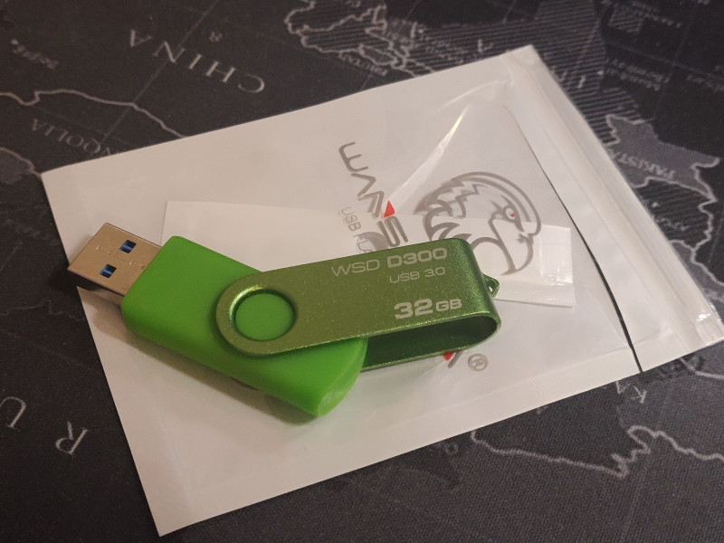
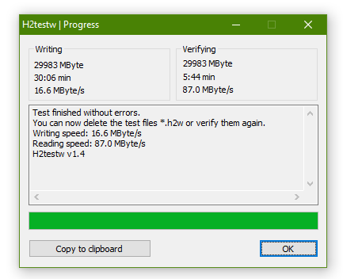
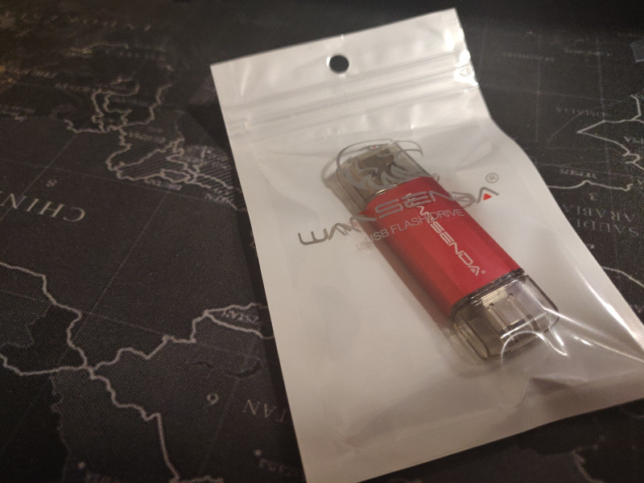
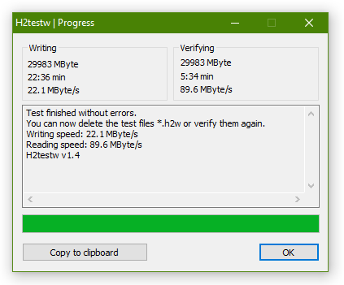
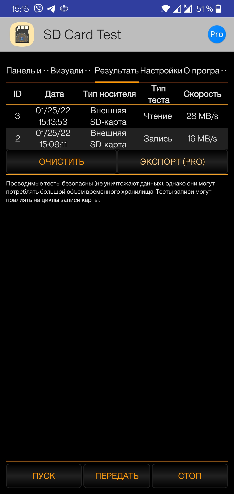
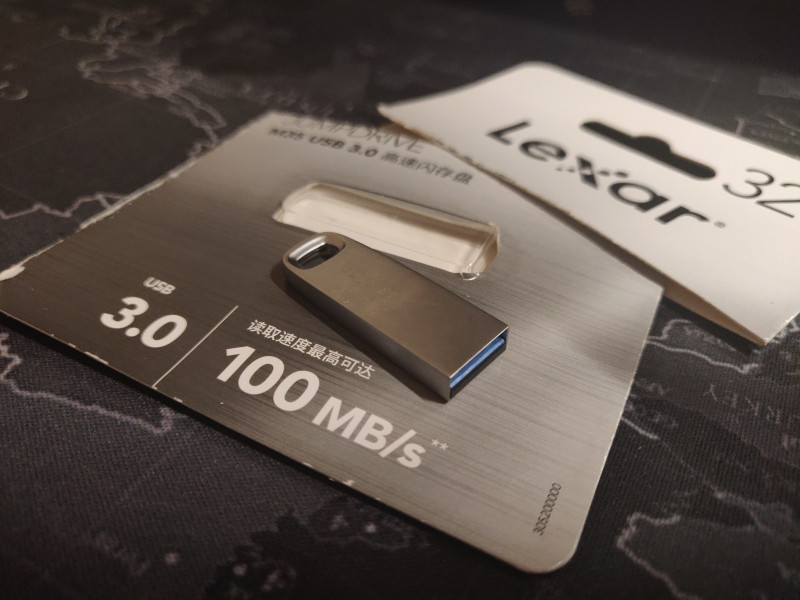
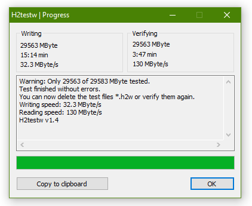
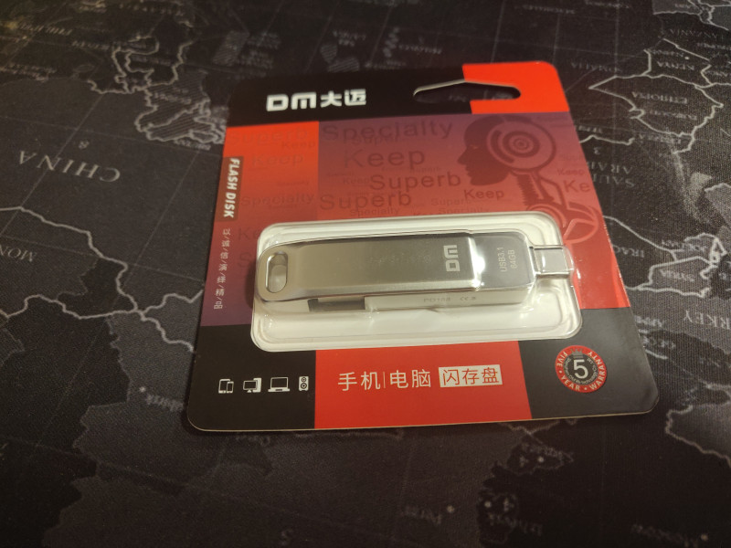
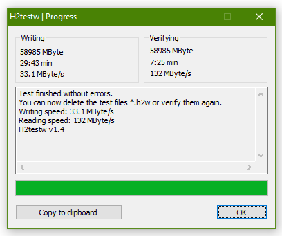
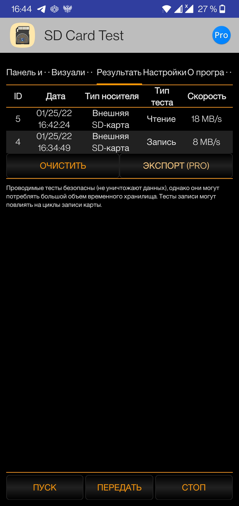

# Флэшки. Январь 2022

Как-то вдруг подумалось что запас флэшек у меня подуменьшился — что-то сдохло, что-то потерялось, что-то отдалось. Поэтому решил его пополнить на очередной распродаже на AliExpress. Искал без фанатизма — чтобы был не откровенный шлак и при этом цена пониже. Понятно, что чудес не бывает, и за 300 рублей скорости записи под 100 МБ/с ждать не стоит.

Что в итоге «выловил».

1. [WANSENDA WDS D300](https://aliexpress.ru/item/1005002318954965.html)

Объем честный, скорости без чудес. Не USB2, но и до USB3 далеко. Запись/чтение = 17/87 МБ/с:

2. [WANSENDA WSD TC100](https://aliexpress.ru/item/4000330438656.html)

Объем тоже честный, по скорости чуть-чуть лучше и есть дополнительно Type-C. Запись/чтение = 22/89 МБ/с:

На смартфоне по OTG через type-C скорости меньше. Запись/чтение = 16/28 МБ/с:

Колпачки держатся неплотно, будут сваливаться.

3. [Lexar M35](https://aliexpress.ru/item/4000341255284.html)

Не S57, как написано в заголовке страницы, а именно M35, который под сталь.

Объем честный, по записи и чтению кардинально лучше предыдущих «товарищей». Запись/чтение = 32/130 МБ/с:

Также на флэшку записана прога DataShield, чтобы делать защищенный контейнер, и пара PDF с инструкцией к ней.

4. [DM DP168](https://aliexpress.ru/item/4000468773200.html)

Объем честный. Скорости на ПК хорошие, но заявленного в названии USB3.1 тут, конечно, и близко нет. Запись/чтение = 33/132 МБ/с:

Скорости на смартфоне через OTG type-C ужасные. Запись/чтение = 8/18 МБ/с:

В целом свои деньги флэшки отрабатывают. Главное объемы честные. Под четными я имею в виду, что раз написано 32Gb, то и будет около того, а не когда вам 2-гиговую флэшку подсунули с контроллером, который выдает себя за 32Gb. То что там байты не по 1024, а по 1000 считают — это все понятно и стандартно.
