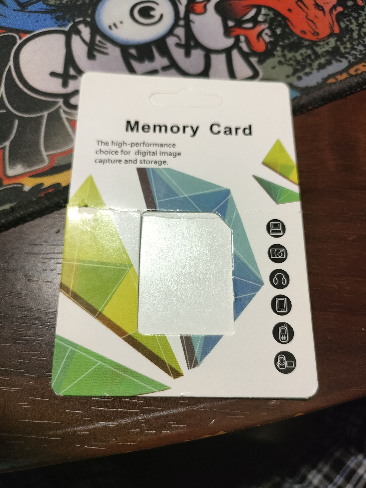

# SD-карты 64ГБ 2024

Купил на Aliexpress 4 SD-карты по 64Гб в разделе фиксированной цены. Все рублей по 300, но типа разные:

* [SomnAmbulist](https://aliexpress.ru/item/1005005929263300.html?sku_id=12000034891068945)
* [AUGAOKE](https://aliexpress.ru/item/1005005065836561.html?sku_id=12000031503430597)
* [Bliksem](https://aliexpress.ru/item/1005004959300638.html?sku_id=12000031157815101)
* [Eldingu](https://aliexpress.ru/item/1005005065843104.html?sku_id=12000031503182600)

Честно говоря, я даже не надеялся, что там будет 64 гигабайта, но... обо всем по порядку.

«Шли» они сборной посылкой и пришли, соответственно, все вместе за стандартные недели 2. При этом, несмотря на то, что они, якобы, разные, все пришли в одинаковой упаковке, вот в такой:

Когда я увидел эту упаковку, я решил что, это будут одинаковые «яйца, только в профиль» с разным принтом. Как же обстоят дела на самом деле?

SomnAmbulist
============

SomnAmbulist 64 GB

На карте указан Class 10 и UHS 3. По факту объём оказался честным — примерно 59 «нормальных человеческих» ГБ. Правда при записи последнего 59го куска в H2testw возникла ошибка:

SomnAmbulist 64 GB write speed and capacity

Как видно на скриншоте выше, скорость записи чуть менее 30 МБ/с, что соответствует C10 и на U3, в принципе, похоже.

SomnAmbulist 64 GB read speed

Поскольку запись в конце «упала», проверка отдельным скриншотом. На нем видна скорость чтения около 87 МБ/с

AUGAOKE
=======

AUGAOKE 64GB

На карте также указаны Class 10 и UHS 3. Результаты проверки:

AUGAOKE 64GB write/read speed

Объём также честный, причем при записи последнего гигабайта никакх ошибок не возникло. Скорости чтения и записи чуть ниже предыдущего испытуемого  — 26 и 75 МБ/с соответственно. C10 соответствует, U3 уже с натяжкой.

Bliksem
=======

Bliksem 64GB

На карте также указаны Class 10 и UHS 3. При записи последнего 59го куска в H2testw возникла ошибка, как и в случае SomnAmbulist:

Bliksem 64GB write

В целом эта SD-карта практически полностью повторяет SomnAmbulist.

Bliksem 64GB read

Время проверки вообще совпадает настолько, что я вначале даже решил, что я перепутал скриншоты. Но нет. Все так и есть  — запись около 28 МБ/с, чтение около  87 Мб/с.

Eldingu
=======

Eldingu 64GB

На карте имеет все те же Class 10 и UHS 3. Результаты проверки:

Eldingu 64GB write/read speed

По скоростям выходит хуже всех предыдущих — 20 МБ/с  на запись, 77 МБ/с на чтение.

Выводы
======

Удивительно, но у всех SD-карт объём оказался честным. Также, несмотря на одинаковую упаковку, похоже карты все таки не «из одной бочки» (ну, разве что SomnAmbulist и Bliksem — сестры-близнецы). Скорости разнятся, но не кардинально, и соответствуют заявленым Class 10, и почти соответствуют UHS 3.

Аутсайдер по скростям это Eldingu. SomnAmbulist и Bliksem самые быстрее тут, но зато какая-то ошибка в самом конце, AUGAOKE помедленнее, зато без ошибок. Первого места нет, второе делят все три.
