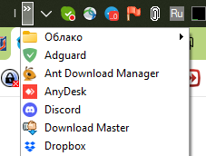

# Windows 11. Меняем Проводник на старый от Windows 10

Через Insider Preview прилетело обновление на Windows 11. Поставил, поигрался. В целом визуально стало красивее, особенно всякие стандартные элементы управления в диалоговых окнах - типа кнопочек, чек- и радио-боксов и тыпы. В общем, надеюсь, когда-нибудь из MSFT  выгонят всех модных «дезигнеров» и винда вернется к интерфейсу Windows 7. Но пока до этого еще далеко и путь не близкий. И на этом пути MSFT снова пытается запрыгнуть на грабли подложенные в Windows 8 — а именно снова перелопатить меню Пуск и, самое главное, Панель задач.

Итак у нас есть новое меню Пуск, которое, слава богу, (пока?) через реестр переключается на старое. Кстати, зацените как MSFT элегантно кинула всех разработчиков динамических плиточек в Пуске — все, нет больше ваших динамических плиточек. Ну, наверное, теперь предложит пилить виджеты (которые у нас вроде в Vista появились под именем гаджетов). В общем Пуск пока можно вернуть человеческий вид, «накрайняк» поставить  Open Shell (бывший Classic Shell). Привет, Windows 8.

Панель задач тоже зацепили «улучшениями». MSFT кто-то рассказал что все любят как в MacOS, и они решили переделать панель в задач в DockBar (ну или как там эта хрень на яблоках называется посередине).

Значит, что они уже успели сломать:

1. Выравнивание по центру. Слава  БГ, можно включить «влево» прямо в настройках панели. Но только влево. Это типа единственный реверанс в сторону типа ретроградов, которым чуждо все модное и современное, а им подавай удобное и настраиваемое. Сарказм если че.
2. Панель может быть только снизу. Через реестр, можно сделать ее сверху. И это даже работает. Что мешало сделать для этого настройку как раньше? Через реестр можно даже сделать ее слева или справа, но это не работает — процесс проводника (если кто не в курсе  — за панель задач и меню пуск отвечает проводник — старый добрый explorer.exe) — отрисовывает панельку слева/справа, но все время крашится и перезапускается.  Это все при том что у большинства мониторы широкоформатные — по бокам места много, а сверху/снизу — мало. Ну логично, MSFT. Сарказм, если че. Впрочем мой кейс — панель сверху — можно было бы жить. Но и тут есть капля дегтя — при верхнем расположении панели, самая правая область, которая отвечает за показ рабочего стола при наведении/нажатии, чуть-чуть не доходит до края и просто вести мышь туда до упора и нажать не сработает — надо чуть сдвигать влево. Когда внизу все ОК. Маразм. Идем дальше.
3. Панель нельзя закрепить/открепить и перетаскивать. Это собственно следствие предыдущего пункта. Не большая проблема, вследствие того что панель закрепляется вверху один раз через реестр и живет там годами. Но как факт.
4. Значки на панели только средние. Через реестр можно сделать маленькие и больше. Почему не добавить настройку? Даже так — нафига убирать настройку, она же была в Windows 10? Тоже не большая проблема — один раз слазил в реестр, поставил как надо, и оно так живет годами.
5. Значки приложений нельзя НЕ ГРУППИРОВАТЬ. Через реестр не правится, старые параметры не работают. А вот это афигенная проблема. Да есть люди, их даже возможно большинство, которые группируют. Половина из них не знает, что можно (было) это отключить. Другая половина, наверное, хочет быть модной. Есть даже, наверное, те, кому это нравится. Я не знаю почему. Это не удобно, это бесит. Ты не видишь сколько у тебя открыто окон приложения (ну, например, Word'ов с Excel'ями), ты не можешь сразу тыкнуть в нужное и тыпы.  Если у вас винда чтобы запустить браузер, тогда наверное да - вам пофиг. Зачем вам винда тогда вообще — поставьте себе Ubuntu — там точно такой же браузер, еще и вирусов нет и бесплатно.
6. Для приложений нельзя выводить метки (заголовки окон). Это вторая афигенная проблема — вы видите только значок, если там разные документы открыты в 10 «вордах»  вы не может сразу ткнуть в нужный.
7. На кнопку приложения в панели задач нельзя перетаскивать файлы. Это еще одна офигенная проблема. Если не понимаете о чем речь — объясняю. У вас на весь экран открыто 2 проводника. Один активный, вы выделяете там файлы, и тащите их на кнопку второго проводника в панели задач, не отпуская, задерживаете над ней мышь, винда вам делает окно второго проводника активным на передний план вы тащите свои файлы в него и копируете/перемещаете. И так с любым приложением. С Window 11 — можете не тащить — ничего вам не активируется. Ставьте 2 окна рядом, используйте буфер. Как угодно. Но не так. «Фтопку» такой UX.
8. В панель задач нельзя добавить свою подпанель на основе папки. Объясняю не примере. В Windows < 11 у меня на рабочем столе сделана папка «I», в ней ярлыки на программы для интернета, на панели задач на основе этой папки сделана подпанель рядом с треем, места почти не занимает, а все что надо под рукой:

   

   В Window 11 вы такое сделать не сможете.

   *А знаете что во времена Windows 98, кажется, любую папку на рабочем столе можно было перетащить к краю экрана и появлялась новая панель аля «Быстрый запуск» с кнопками файлов в этой папке. В какой момент сдохла эта фича? Сколько таких фич сдохло с тех пор (Active Desktop, например)?  Интерфейс винды, очевидно, деградирует.*
9. В контекстном меню Панели задач только 1 пункт — Настройки панели задач. Никаких больше «Расположить окна...», «Показать рабочий стол», «Диспетчер задач». Не особо ими пользовался, но кому оно мешало? Нет чтобы сделать официальную возможность расширения такого меню. Так наоборот — все урежем <картинка с лавровым>.

Так с минусами понятно. Какие есть новые плюсы у панели задач в Windows 11:

1. Никаких.... Реально. Все что сделано, это сломано то, что работало, ради ничего. Разве что выравнивание по центру, но люди, которым это надо, давно себе поставили какой-нить \*Dock или перешли на Mac.

В общем я «потусовался» с этим косяками, с какими-то смирился, но в итоге решил, что надо вернуть старый проводник из Windows 10, где все как надо с панелью задач и пуском. А самим проводником как файловым менеджером я все равно не пользуюсь почти (хотя и его MSFT тоже «изуродовали» упрощением).

Итак по пунктам:

1. Вам надо достать  файл explorer.exe от Windows 10. Если вы обновлялись, то, скорее всего, в папке C:\Windows.old\Windows лежит нужный файл. Если нет - ну "наройте" его из какого-нибудь установочного образа Windows 10. Файл explorer.exe от Windows 10 нужно положить в C:\Windows под именем explorer10.exe
2. Сделайте копию существующего explorer.exe в explorer11.exe
3. Вам нужно будет отключить проверку цифровой подписи на постоянку иначе при попытке запуска старого проводника винда будет выдавать "*Program 'explorer.exe' failed to run: Windows cannot verify the digital signature for this file. A recent hardware o r software change might have installed a file that is signed incorrectly or damaged, or that might be malicious soft ware from an unknown source*". Если вы этого еще не сделали введите в терминале (или PowerShell, возможно нужно под администратором) команду:

   ```
   bcdedit /set testsigning on
   ```

   и перезагрузите комп.
4. Теперь нужно разрешить себе менять explorer.exe. Для этого в его свойствах в разделе Безопасность надо дать себе полный доступ. Но поскольку Вы не владелец файла и каталога (владелец TrustedInstaller), дать доступ не выйдет. Поэтому вначале там же в безопасности надо сдать владельцем, а потом уже дать себе или всем полный доступ к explorer.exe.
5. Теперь нам нужно скопировать explorer10.exe в explorer.exe, заменив последний. Этого нельзя сделать Проводником поскольку это он и открыт. Можно сделать другим файловым менеджером или из консоли, если предварительно убить процесс Проводника, так чтобы панель задач тоже пропала. Делать будем в консоли из под администратора. Для этого пока проводник еще открыт нажимаем Win+X и запускаем из него Диспетчер задач и "Терминал (или PowerShell) под администратором". В диспетчере задач находим все процессы Проводник и убиваем ("снять задачу"), панель задач должна исчезнуть. Переключаемся на Терминал, переходим в C:\Windows если мы еще не там (пишем **cd C:\Windows**), дальше копируем explorer10.exe в explorer.exe командой

   ```
   cp explorer10.exe explorer.exe
   ```

   , далее запускам проводник, набрав **explorer**.
6. Если что-то пошло не так, откатываем вначале проводник на 11 версию

   ```
   cp explorer11.exe explorer.exe
   ```

   и потом разбираемся.
7. Если из панели пропали часы и иконка центра уведомлений, откройте редактор реестра regedit, убейте процесс Проводника, в реестре удалите раздел HKEY\_CURRENT\_USER\Software\Microsoft\Windows\CurrentVersion\Explorer\StuckRects3 и запустите Проводник заново.

Если все ок радуемся жизни, до следующего обновления, которое, возможно принесет новый explorer.exe. Если MSFT не одумается и не вернет все нужные фичи, повторяем процесс убиения и замены.
Ахтунг! После такой подмены почему-то перестает работать Win+X (или ПКМ на Пуске). Для меня это меньшее зло чем группировка, а так решать вам.


*Настроение:* бодр(а)
