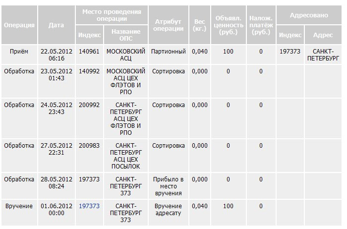
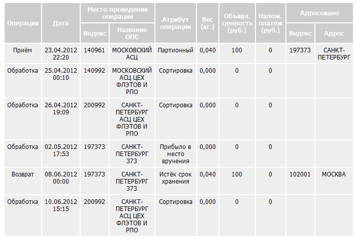

# Почта России. Письмо должно быть долгожданным.

 Яндекс начал в апреле выдавать желающим банковскую карту к своим Яндекс.Деньгам. Я себе такую заказал. 23 апреля мне ее отправили из Москвы в Питер. 2 мая она пришла в мое почтовое отделение. Прошло чуть больше недели, вроде бы вполне нормальный срок, но не тут-то было. Поскольку карту я ждал и отслеживал по [трекингу](http://russianpost.ru/resp_engine.aspx?Path=rp/servise/ru/home/postuslug/trackingpo) где находится посылка, то после 2го мая "мониторил" ящик практически каждый день. Извещения не было...
Прошел почти месяц. 22 мая Яндекс прислал письмо, в котором говорилось, что в предыдущей карте они нашли ошибку и что они выслали вместо нее новую, а старой пользоваться не надо. 22 мая же они выслали из Москвы новую карту - 28 мая она пришла в почтовое отделение (обратите внимание - меньше недели!!! могут когда хотят). Поскольку я все также мониторил почтовый ящик - то получил извещение и 1го июня получил свою карту. Вот скриншот трекинга:

Причем, учитывая что я не получил еще первую я думал, что это она и есть, а вторая опять придет через месяц. Но оказалось, что это именно вторая карта. О судьбе первой оставалось только догадываться, я даже подозревал, что Яндекс ее как-то отозвал. Но поскольку она была с браком, особо я не волновался. И ящик уже не проверял каждый день. И вот где то числа 6го или 7го, проверяя ящик, я вдруг обнаруживаю еще одно извещение с пометкой "Срочно 08.06". Извещение именно на первую карту. Поскольку как правило я появляюсь с работы в районе дома уже позже той отметки времени, до которой работает почтовое отделение, то резонно решив, что отлежав месяц на почте, карта за пару дней не испортится, я откладываю поход за ней на выходные.
09.06 отделение не работало, потому что у них был переезд после ремонта. 10го у них был выходной. На почту я попал в итоге только 11го. Но все равно это уже было бесполезно ибо поздно. Смотрим трекинг:

8го числа посылка была отправлена назад. На почте (кстати я отстоял 50 минут в очереди из 5-6 человек, ну это мелочи) мне это рассказали с объяснением, что посылка хранится только месяц. А также пытались доказать что, это уже повторное извещение. Хотя я повторяю мониторил ящик каждый день со второго мая. Кроме того я знаю как они шлют повторные - раз в 3 дня, а то и чаще.
Давайте признаем очевидное - в отделении "проебали" мою посылку. Не в смысле "потеряли", а в смысле "положили и забыли". Проходит месяц, они вдруг ее "находят" и в срочном порядке "вставляют в конвеер". Но у них же инструкция. А в этой инструкции русским по белому написано, что посылки хранить не больше месяца. Иначе не дай бог придет какая-нибудь коммисия и сделает им ай-яй-яй за это. А за то что месяц нет извещения ай-яй-яй никто не сделает. Ну подумаешь человек расстроиться, ну поругается и уйдет. Плевать - их вон еще сколько в очереди осталось...
