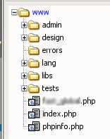

# CVS в Zend Studio

Сейчас пробую на зуб Zend Studio 5.5 и наткнулся в ней на интегрированную возможность работать с системой контроля версий. Поддерживаются наиболее актуальные на данный момент CVS и SVN. Пока остановился на CVS.
Но поскольку я с системами контроля версий особо не сталкивался, заставить работать Zend Studio с CVS получилось не сразу. Справка особо не помогла, но "метод научного тыка" в итоге сработал, и все вроде завертелось как надо. Под катом русским по белому написано, что и как делать. Надеюсь кому-нибудь это пригодится.
Значит давайте определим начальные условия. Допустим мы разрабатываем сайт **MySite**. Сайт лежит в папке **C:\Projects\Web\MySite**. В Zend Studio создан проект, который также называется **MySite**. И мы хотим использовать при разработке своего сайта CVS. CVS использует в своей идеологии понятие репозитария. Что это такое и как оно используется - это вы почитайте в интернете. Здесь нам важно, что репозитарии будут храниться у нас же на компьютере (то есть локально), скажем, в папке **D:\Sources\CVS**. Наш сайт **MySite** в частности будет лежать в **D:\Sources\CVS\MySite**. Репозитарий пока не существует.
Что делаем

1. Прежде чем что либо делать с существующим проектом, советую его все же "зарарить" куда подальше
2. Создаем папку **D:\Sources**, в ней папку **CVS**, а в ней **CVSROOT**
3. Теперь нужно открыть командную строку (Total Commander, FAR etc), перейти в папку **C:\Program Files\Zend\ZendStudio-5.5.0\bin\SourceControl\cvs\** и выполнить команду **cvs -d :local:d:\sources\cvs init**. После этого в папке D:\Sources\CVS появится папка CVSROOT и куча служебных файлов в ней.
   *Примечание. Первоначально я создавал папку CVSROOT вручную и все работало, но так вроде правильнее*.
4. Дальше возможны 2 варианта работы. Во-первых можно импортировать весь существующий проект в репозитарий. Второй путь подразумевает ручное добавление нужных файлов и папок по одному. Кажется, что первый путь проще, и это на само деле так, но тут есть подводные камни. Например, при импорте в репозитарий будут скопированы все файлы, находящие в каталоге проекта и его подкаталогах, что возможно лишнее. Также по умолчанию все переносимые в репозитарий файлы интерпретируются как текстовые, что создаст проблемы с картинками - они просто станут битыми. Правда все это потом можно починить.
   Так что, если Вы выбираете второй путь, то просто в папке **D:\Sources\CVS** создаем папку **MySite**. Те кто хочет пойти по первому пути должны сделать следующее:
   1. Для начала скопируйте файл **cvs.exe** в папку **C:\Projects\Web\MySite** (или поместите путь к нему в переменную PATH, или пропишите путь к нему целиком, или создайте батник - короче как удобнее, главное чтобы находясь в папке **C:\Projects\Web\MySite** можно было вызывать cvs в командной строке).
   2. В командной строке, находясь в папке C:\Projects\Web\MySite, пишем следующую команду **cvs -d :local:D:/sources/cvs import -m "<comment>" mysite <user> <version>**. Вместо <comment> нужно написать любой комментарий к этой операции, что-то вроде "Import project to CVS". Вместо <user>- имя разработчика (себя то есть), что-то вроде MeGaPHPCoDeR =). Вместо <version> - имя этой версии проекта. Если только начали можно написать Initial, если проект уже имеет нумерацию можно написать ее - тут правил нет, как удобнее.
   3. Если все сработало, то сейчас весь наш проект в репозитории и из рабочего каталога его нужно удалить. Нужно, а не можно.
5. Открываем Zend Studio и закрываем в ней проект, если он открыт
6. В меню выбираем пункт *Tools - CVS - Checkout*. В открывшемся диалоговом окне:
   * В *CVS Root* пишем **D:\Sources\CVS\**
   * В *Module name* пишем **MySite**
   * В *Working directory* пишем **C:\Projects\Web\**То есть в *CVS Root* указывается пусть к репозитарию вообще, в *Working directory* к рабочему каталогу с проектами, а *Module name* фактически имя проекта (вернее имя папки, в которой у вас хранится сам проект - с учетом того что папка находится в *Working directory*).
7. После нажатия OK система CVS проведет первый checkout и напишет в открывшемся окне **Source Control Output** что-то вроде следующего:
   `C:\Program Files\Zend\ZendStudio-5.5.0\bin\SourceControl\cvs\cvs.exe -d D:\Sources\CVS\ checkout -m '' mysite
   ? mysite/error.log
   ? mysite/www
   cvs.exe checkout: Updating mysite
   cvs command finished with exit code 0`
   Если Вы импортировали до этого весь проект в репозитарий, вывод будет другим.
   Кстати, сейчас в папке **C:\Projects\Web\MySite\** у нас образовалась еще одна папка **CVS** и несколько файлов в ней. Такие папки будут создаваться в каждой папке нашего проекта, которую мы добавим в репозиторий. Папки в репозиторий нужно добавлять согласно их иерархии, то есть нельзя добавить файл в репозиторий, пока в него не добавлена папка, в которой он находится.
8. Если Вы пошли по второму пути, то добавим первую папку. В папке нашего проекта есть одна папка **www**, в которой уже собственно и лежит сам проект, и файл error.log, который оставляет Apache. Последний мы в проект не включали и, естественно, в репозиторий его тоже заносить не будем. Структура проекта в Zend Studio имеет следующий вид
   
   Добавляем папку www, для чего нажимаем на ней правой кнопкой и во всплывшем меню выбираем **CVS - Add** Заметьте, что для остальных файлов и папок пункт CVS пока неактивен. ZendStudio выведет диалог, в которой попросит написать какое-то Log Message. Что это - я пока не понял. Напишем что-то типа *"First Add"* и нажмем OK. Студия выведет в окне **Source Control Output** лог добавления папки www. В результате этих действий у нас в репозитарии в папке нашего сайта появилась папка www, для папки www во всплывающем меню стали доступны другие команды из подменю CVS, а меню CVS стало доступно для других папок и файлов, находящихся в папке www. Также файлы в папке www окрасились в другой цвет.
9. Напоследок напишу про добавление файла, потому что есть особенности. Добавляем файл index.php из папки www, для чего тыкаем на нем правой кнопкой и в меню выбираем пункт  **CVS - Add**. Во всплывшем диалоге опять пишем какой-нибудь Log Message и нажимаем OK. ZendStudio выведет лог добавления файла. Файл окрашивается в свой цвет (по умолчанию в зеленый), но заметьте, в репозиторий при этом пока ничего не добавилось. Чтобы окончательно переместить файл в репозиторий нужно над ним или над любой из его роздительских папок выполнить команду **CVS - Commit**. То есть, сейчас можно "понадобавлять" все файлы и папки вашего проекта, а затем применить **CVS - Commit** один раз на папку www и все файлы будут перенесены в репозитарий.

Система настроена, с ней можно работать. Как это делать - читайте где нибудь в другом месте. А именно:
[Управление исходными текстами](http://www.rsdn.ru/article/devtools/cvs.xml)  
[CVS -- Система Управления Параллельными Версиями](http://alexm.here.ru/cvs-ru/cvs-ru.html)  
[Работа с CVS в Zend Studio 4.x (Windows)](http://php.russofile.ru/ru/translate/unsort/cvs_and_zend/) - как заставить работать Zend Studio с CVS на [Sourceforge.net](www.sourceforge.net.)  
[Тут есть кое, что про Zend и его настройку](http://www.parabox.ru)

*Музыка:* Franz Ferdinand - Auf Achse | *Настроение:* ворочу горы
